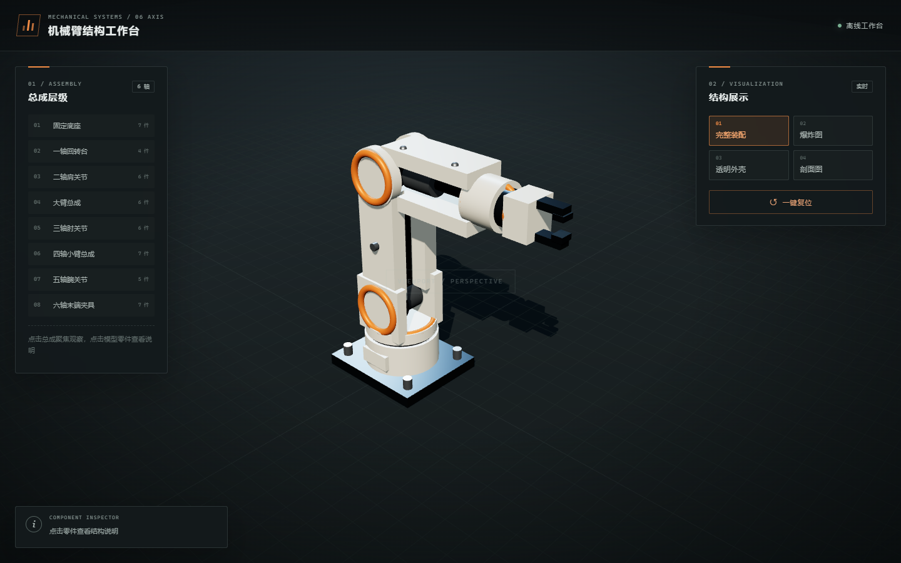
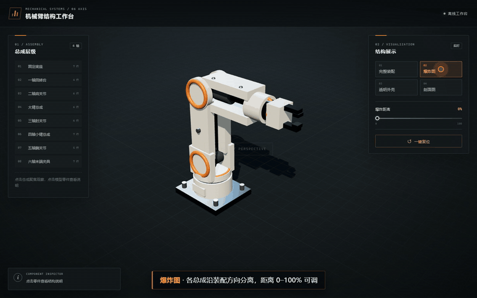

# 六轴机械臂结构工作台

一个用于结构教学演示的浏览器 3D 机械臂。48 个可点选零件、8 个总成，支持完整装配、爆炸图、透明外壳和 X/Y/Z 剖面四种查看方式。构建产物是**单个可离线双击运行的 `index.html`**，运行时不加载 CDN 或任何外部资源。

**在线演示：<https://www.sakura.work.gd/robot-arm-structure-workbench/>**



## 功能演示



完整 33 秒演示（含零件拾取、总成聚焦与一键复位）：[demo/robot-arm-demo.mp4](demo/robot-arm-demo.mp4)

## 功能

| 模式 | 作用 | 可调参数 |
|---|---|---|
| 完整装配 | 观察整机，点击零件查看中文结构说明 | 无 |
| 爆炸图 | 各总成沿装配方向分离 | 爆炸距离 0–100% |
| 透明外壳 | 外壳透明化，内部电机、减速器保持不透明 | 外壳透明度 0–100% |
| 剖面图 | 用裁剪平面实时切掉模型一侧 | X/Y/Z 轴、剖切位置 |

- 左侧总成层级可一键聚焦到底座、回转台、肩部、大臂、肘部、小臂、腕部、末端夹具。
- 鼠标左键旋转、滚轮缩放、右键平移；缩放以光标位置为中心。
- 一键复位会同时恢复模式、参数、选中零件和相机。
- 窄屏下面板折叠为底部抽屉，3D 视口保持可见。
- WebGL2 不可用时显示明确提示，而不是空白画布。

## 直接使用

下载仓库里的 [`index.html`](index.html)，双击即可。不需要 Node.js、服务器或网络。

## 本地开发

```bash
npm install
npm run build        # 打包并内联 Three.js / CSS / JS，生成 index.html
npm run test:unit    # 构建产物、状态机、模型结构测试
npm run test:browser # 真实 Chrome 的 file:// 交互、离线、WebGL 降级与截图测试
npm test             # 全部
```

浏览器测试使用本机 Chrome（`C:/Program Files/Google/Chrome/Application/chrome.exe`）和 SwiftShader，可在无 GPU 的环境跑通。

## 目录

```text
src/
  model.js      程序化机械臂模型、零件元数据、爆炸方向
  state.js      纯函数状态 reducer
  display.js    爆炸位移、外壳透明、裁剪面、选中高亮
  viewer.js     渲染器、相机、光照、拾取、聚焦
  ui.js         模式按钮、滑块、总成树、零件说明、响应式面板
  main.js       应用装配、状态分发、按需渲染循环
  styles.css    工业风主题与窄屏布局
scripts/build.mjs  esbuild 打包并内联为单文件
tests/            单元测试与 Playwright 真实浏览器测试
```

## 说明

模型是按教学示意程序化生成的，用于理解六轴机械臂的总成划分与传动关系，不具备工程级 CAD 的尺寸和装配精度。

## License

MIT
